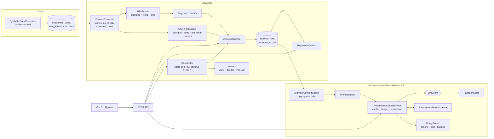
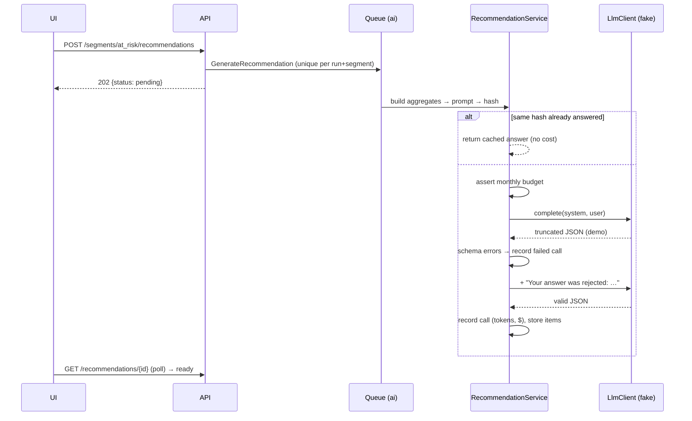

# AI Retention Analytics

[](https://github.com/maxakagaret/ai-retention-analytics/actions/workflows/ci.yml)

Customer segmentation (RFM), explainable churn-risk scoring and LLM-generated retention campaigns for appointment-based businesses. Built with Laravel 12 and Vue 3 / Quasar on a synthetic customer base.

> Everything is synthetic and offline. Customers come from a seeded generator with known behaviour profiles. The LLM sits behind an interface and is served by a deterministic fake that "reads" the prompt. No real people, no real API calls.

## What it demonstrates

| Topic | How |
|---|---|
| RFM segmentation | Recency and Monetary scored by quintiles of the current base; Frequency by fixed bins (count data with heavy ties); 10-segment map |
| Explainable churn risk | 0–100 score from *personal* rhythm (days since last visit ÷ the customer's median gap), visit trend and one-timer flag. Every score lists its factors and their weight |
| Measured, not claimed | Backtest replays the model at a past date with only the data known then. It compares the score with what happened next: ROC AUC vs a recency-only baseline, calibration by decile, precision@100 |
| Snapshots | Every analysis is an immutable snapshot, so segment migration ("who slipped from loyal to at-risk") is a join between two runs |
| LLM with guardrails | The prompt holds aggregates only (a test proves no names or emails leak), the answer is checked against a schema, invalid answers are sent back with the errors (self-repair), cache by prompt hash, token and cost accounting, monthly budget, async job |
| Synthetic data with ground truth | 7 behaviour profiles (loyal, fading, churned, recently churned, new, one-off, seasonal), reproducible by seed. The UI shows the hidden profile next to the score for sanity checks |

### Results on the demo data (1 500 customers, seed 2026)

| Metric | Value |
|---|---|
| ROC AUC, churn model | **0.83** |
| ROC AUC, "longest absence first" baseline | 0.81 |
| Precision of the top-100 risk list | 1.00 |
| Actual churn rate, risk 0–9 → risk 90–99 | 32% → 100% (rising across deciles) |

The baseline is strong on purpose: on this kind of data recency alone is very predictive. The model's gain comes from judging lateness against each customer's own rhythm and from the trend signal. Reported honestly, this is a modest but real improvement, not a magic number.

## Architecture



### Recommendation pipeline



## Model details

**Features.** Computed as of a date, using only visits on or before it:
- days since the last visit;
- visits and spend in the last 365 days;
- visits in the last 180 days vs the 180 days before;
- personal rhythm: the median gap between visits, with at least 3 visits needed. Otherwise the typical repeat interval of the customer's most frequent service is used.

**Churn risk.**

```
overdue  = 1 / (1 + e^(−2.4 · (days_since / rhythm − 1.6)))   # logistic: a bit late is normal, 3× late is not
trend    = max(0, (visits_prior180 − visits_last180) / visits_prior180)
risk     = 100 · min(1, 0.7·overdue + 0.2·trend + 0.1·one_timer)
```

The weights, curve and windows are in `config/retention.php`. Every change can be checked with `php artisan retention:backtest`.

**RFM segments.** The R and F scores are mapped by ordered rules: Champions, Loyal, Potential loyalists, New customers, Promising, Need attention, At risk, Can't lose them, Hibernating, Lost. Each segment has a retention goal that becomes part of the LLM brief.

## API

| Method | Endpoint | Purpose |
|---|---|---|
| GET | `/api/overview` | Latest snapshot summary + latest backtest |
| GET/POST | `/api/analysis/runs` | List snapshots / score now (`as_of` optional) |
| GET | `/api/analysis/migration?from=&to=` | Segment transition matrix (defaults: the two latest runs) |
| POST | `/api/analysis/backtests` | Replay the model (`horizon_days`, 30–365) |
| GET | `/api/segments` | Segments with size, revenue share, average risk, revenue at risk |
| GET | `/api/segments/{segment}/customers?sort=` | Customers with risk and main reason |
| GET | `/api/customers/{id}` | Profile, factors, score history, visits |
| POST | `/api/segments/{segment}/recommendations` | Queue generation (`force` to bypass the cache) |
| GET | `/api/recommendations`, `/api/recommendations/{id}` | Results (poll) |
| GET | `/api/ai/usage` | Calls, failures, tokens, cost, latency, monthly budget |

Console commands:
- `retention:analyze [--as-of=]` runs nightly;
- `retention:backtest [--horizon=90]` runs weekly and prints the AUC and the decile table.

## Running it

```bash
docker compose up -d --build
```

- UI: http://localhost:5175
- API: http://localhost:8082/api

The first start generates 1 500 customers (`DEMO_CUSTOMERS`) and builds:
- two snapshots 30 days apart, for the migration view;
- a backtest;
- AI recommendations for the retention-priority segments.

The fake model deliberately answers with broken JSON first, so the repair loop shows up in "AI usage". Turn this off with `AI_FAKE_MALFORMED_FIRST=false`.

## Tests

```bash
docker compose exec app vendor/bin/pest
```

The suite covers:
- quintiles and scoring;
- the segment rules;
- AUC (including ties and a hand-computed case), deciles, precision@k;
- the churn model: personal rhythm vs absolute days, factor ordering, the cap at 100;
- feature extraction: the median rhythm, the fallback interval, the analysis window, **no leakage of future visits**, inactive customers dropped;
- snapshots and migration;
- a backtest on generated data (AUC > 0.75 and ≥ the baseline, rising calibration);
- the reproducible generator;
- the LLM pipeline: the repair loop, giving up after the retry limit, cache, budget, **no personal data in the prompt**;
- API endpoints;
- the full seeder.

## Project layout

```
backend/app/
  Analytics/
    Synthetic/SyntheticDataGenerator.php
    Churn/       FeatureExtractor, CustomerFeatures, ChurnRiskModel
    Rfm/         RfmScorer
    Backtest/    Backtester, Metrics
    AnalysisService.php, SegmentMigration.php
  Ai/
    Contracts/LlmClient.php      ← integration seam
    Fakes/FakeLlmClient.php
    Recommendations/  SegmentContextBuilder, PromptBuilder, RecommendationSchema, RecommendationService
    UsageMeter.php
  Enums/Segment.php              segment rules, labels, retention goals
  Jobs/GenerateRecommendation.php
frontend/src/pages/              Dashboard, Segment (customers + AI panel), Migration matrix, Model quality, AI usage
```

## Plugging in a real model

Implement `App\Ai\Contracts\LlmClient::complete()`: map `LlmRequest` (system prompt + messages) to the provider's chat API and return the text and token usage in `LlmResponse`. Then bind it in `AppServiceProvider` and add the model's price to `retention.ai.pricing`. Caching, budget, schema validation and accounting stay unchanged.

## Out of scope

- Authentication and multi-tenancy.
- Statistical uplift measurement of the campaigns themselves: that needs real outcomes or holdout groups.
